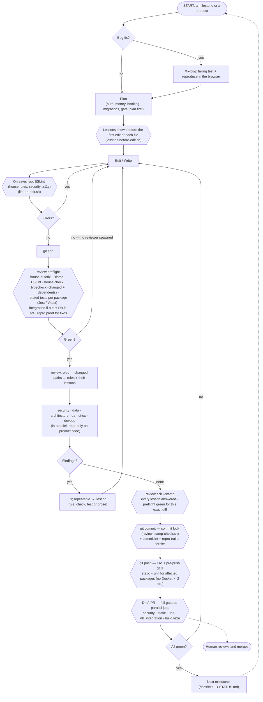
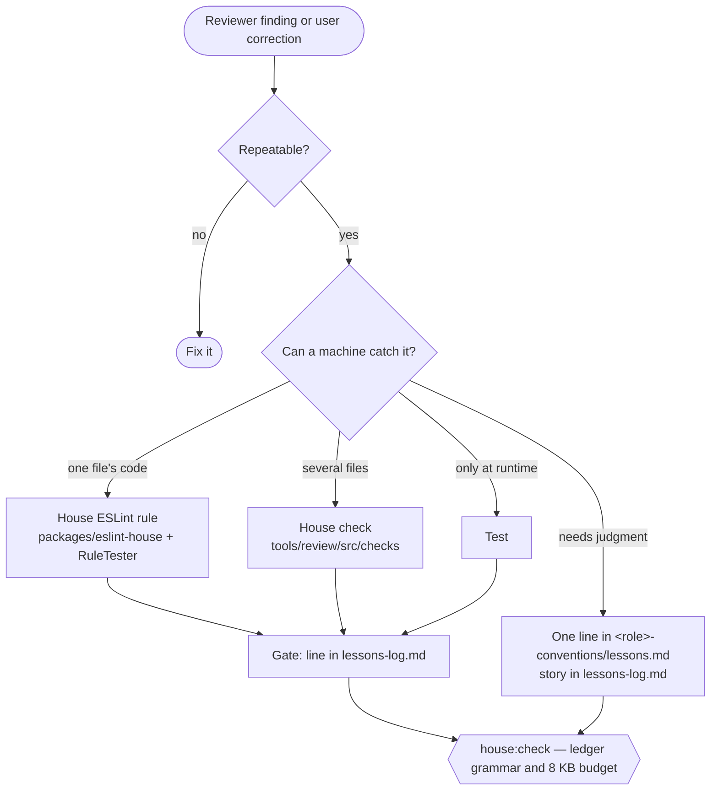

# Agent workflow — from change to merge

How a change moves through the Claude Code tooling and the deterministic gates, and how a
mistake becomes a permanent rule. Carried over from the owner's nxlvl repository and adapted
to this monorepo. The reasons are in ADRs 0015–0018 and 0021 (`docs/DECISIONS/`).

**Hexagons are deterministic** (same result every time, whatever Claude remembers).
Rectangles are steps; the six reviewers are judgment.

## Chart 1 — Build → review → ship

## Chart 2 — Learning loop (`/lesson`)

## Where each gate runs

| Gate | When | What |
|---|---|---|
| Lessons before edit | first edit of a file per session | that file's prose lessons |
| Lint on save | every Edit/Write by Claude | root ESLint on the file |
| `review:preflight` | before reviewers | see Chart 1 |
| Commit lock | every commit (Claude hook + lefthook) | staged diff = stamped diff |
| Pre-push | every push | `verify.sh --only static,unit --affected <base>` |
| Pull request | every push to the PR | `verify.sh` stages as parallel jobs |
| Nightly | 07:00 UTC | `verify.sh --only security` |
| On demand | before submission, or when Actions is down | `pnpm verify` (everything) |

## Where enforcement is soft

- `SKIP_REVIEW=1`, `Repro: not testable` and `SKIP_E2E=1` are visible opt-outs.
- A reviewer must answer every lesson but can answer one wrongly.
- Required status checks are not available on this private repo's plan; merging only on
  green is a convention.
- The bootstrap commit of the tooling itself was made with `SKIP_REVIEW=1`, because the
  reviewers it installs did not exist yet. Every later product commit goes through the lock.

## Source of truth

| Piece | File |
|---|---|
| On save | `.claude/hooks/lint-on-edit.sh` |
| Lessons before edit | `.claude/hooks/lessons-before-edit.sh` |
| Reviewers can only report | `.claude/hooks/agent-write-scope.sh` |
| Commit lock | `.claude/hooks/require-review-before-commit.sh` → `scripts/review-stamp-check.sh` |
| Roles, preflight, ack, repro | `tools/review/src/{_review,review-preflight,review-ack,repro-proof}.ts` |
| Lessons ledger and checks | `tools/review/src/_lessons.ts`, `tools/review/src/checks/`, `pnpm house:check` |
| House rules | `packages/eslint-house/src/index.js` |
| Git hooks | `lefthook.yml` |
| Gate stages | `scripts/verify/verify.sh`, `.github/workflows/verify.yml` |
