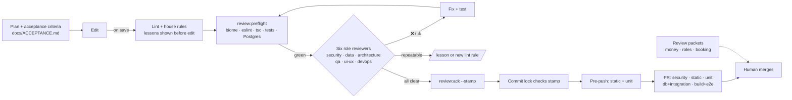

# AI-assisted development — evidence (draft)

Deliverable 3: a workflow diagram and at most 500 words. Draft written from the repository's
own records: commits, saved reviewer reports in `.claude/.review/`, `docs/BUILD-STATUS.md`
and `docs/review-packets/`. The author reviews it, owns it and changes it before submission.

## What the AI did and how it was checked (≈420 words)

**Tool.** Claude (Claude Code) was the only AI tool. One session planned, built and
orchestrated the work. Six reviewer agents, each limited to one role's checklist and
conventions, read every staged diff and could not edit it. A second agent built the
backoffice on its own branch, in parallel, once the API contract was fixed.

**The loop.** No commit lands without a green preflight and a review stamp. The commit hook
refuses an unreviewed diff. Pre-push runs a fast static and unit gate. The pull request runs
the full gate: secret scanning, Semgrep, dependency audit, integration tests against a fresh
Postgres, the build and Playwright.

**What review caught that the author's agent missed** (examples from the saved reports):

- *Gate fail-open.* The verify script reported a failed stage as passed (a bash 3.2 empty
  array plus an EXIT trap). Fixed and tested (`cabcddc`).
- *Blind architecture rules.* dependency-cruiser never saw cross-package imports, so every
  direction rule passed vacuously. Each rule was then proven with a deliberate violation.
- *Money.* The DTI cap was compared after rounding to four places. It is now compared
  exactly.
- *Authorisation.* Role was trusted from the session token for 8 hours. It is now re-read
  from the staff table on every request (R-9).
- *A race.* A draft edited while the bureau was answering could be auto-approved on terms
  the decision never scored. Submit now refuses a changed version (A-5).
- *Records.* The B-8 cross-check used inner joins, so a disbursed loan missing its account
  would silently pass. It now fails.
- *A real hang.* A stronger concurrency test deadlocked the connection pool, as the data
  reviewer had predicted. The pool is now bounded, and the limit is in ADR 0020.

The M3–M7 server commit took two review rounds. Round 1 raised nine blocking findings
across six roles; round 2 raised none. Repeatable findings became house lint rules (21
today, each with tests), for example: a case status can only change through the transition
table.

**Human control.** Review packets for money, roles and booking each list three things to
check by hand. Assumptions the materials left open (personas, product limits, the override
definition) are written in `docs/ASSUMPTIONS.md`, not decided silently. Agents cannot merge;
the author merges the pull request.

**Limits of the AI.** Reviewers sometimes proposed fixes that would have overreached (an
ADR for one sentence of documentation). Their output was treated as findings to verify,
not instructions. Each claim of "fixed" is backed by a test named in `docs/ACCEPTANCE.md`.
