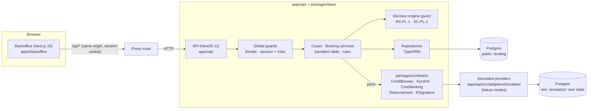
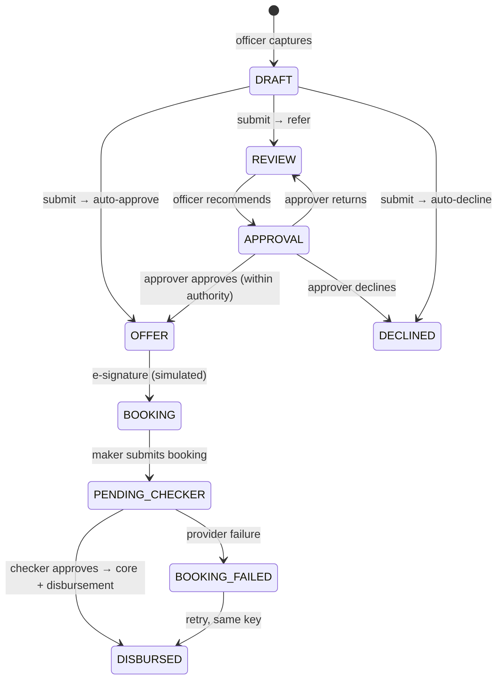

# WhiteBank Lending MVP — Product and Technical Design Notes

Personal loan from application to booking · AI'm Ready Product Engineer Challenge · draft of
27 Nov 2026 · repository: github.com/khaizerdnwc/loan-app

## 1. Problem and scope

**Problem.** WhiteBank wants to see that a modern origination and decisioning flow can be
trusted with real lending decisions before committing to the full build (PRD v0.1).
**Users** in this slice: the loan officer (capture and referral review), the approver
(decisions within authority), loan operations and its supervisor (signing, booking maker and
checker), compliance (read-only), and an admin who only switches simulated failures.

**In scope** — PRD flows F1 (auto-approve) and F2 (referral with counter-offer), the F6
sanctions decline, and the failure cases: capture with product limits, a deterministic and
reproducible decision (knockouts → triggers → scorecard → bands), referral review with
overrides, approval within amount-and-grade authority, simulated e-signature, booking and
disbursement with maker-checker and idempotency, full case history, and simulated bureau,
KYC/AML, core banking, disbursement and e-signature behind ports.

**Deferred (against the PRD)** — borrower app; information requests, documents, OCR and
statement analysis; credit memo; credit committee; collateral and home loans; collections;
configuration screens; SLA timers and notifications; MFA/SSO; multi-tenancy; sandbox and
live provider modes; real AML list screening (the mechanics forbid real providers).

**Success criteria** — every acceptance criterion in `docs/ACCEPTANCE.md` names a passing
test (46 criteria, all ☑); the full gate is green on the pull request (security, static,
unit, integration on a fresh Postgres, build and Playwright); F1, F2, an authority breach, a
bureau outage and a failed-then-retried booking pass as browser journeys. Evidence today: 78
API integration tests, 545 unit tests (API 332, domain 72, backoffice 78, UI 24, money 37,
contracts 2) and 6 browser journeys.

**Key assumptions** (`docs/ASSUMPTIONS.md` has the full list): the prototype's product
(₱20,000–₱500,000, 6–36 months, ₱300,000 auto-approval limit), knockouts (age 21–65,
sanctions, default, identity), bands (decline < 600, refer 600–699, approve ≥ 700) and
add-on pricing by grade; a scorecard tuned so the PRD's examples land where the PRD says
(Maria 742 A, Joel 612 C); a trigger refers "regardless of score"; the approver Rina has
₱1,000,000 and grades A–C (PRD), Ben ₱100,000 and A–B (to show a breach).

## 2. Representative journey — F2, a referred loan across roles

| Step | Who | Acceptance criterion (test) |
|---|---|---|
| Capture ₱200,000 / 36 for Joel and submit | Loan officer | F2-1: Refer, score 612, grade C, R01 thin file + R06 score band |
| Open the case | Loan officer | F2-2: applicant, every rule result, score, reasons, trigger shown |
| Counter-offer ₱120,000 / 36 without a reason | Loan officer | F2-3: refused (OVERRIDE_REASON_REQUIRED), nothing changes |
| Counter-offer with reason OV04 + rationale | Loan officer | F2-4: case to Approval, override recorded |
| Ben tries to approve | Approver (₱100,000, A–B) | R-6: 403 AUTHORITY_LIMIT_EXCEEDED, case flagged escalated |
| Rina approves | Approver (₱1,000,000, A–C) | F2-5: Offer at ₱120,000 / 36 / 1.60% a month |
| Record e-signature, submit booking | Loan operations | F1-3, B-1: one booking request, one key |
| Approve booking | Supervisor ≠ maker | F2-6, R-5: account, 36 reconciled lines, one disbursement |

Every step writes an activity event (who, what, when, from → to) in the same transaction.

## 3. System view

Only `simulated-providers.module.ts` names a concrete provider; services depend on the
ports, so a real bureau or core replaces one binding (Engineering Standard 9). The
dependency direction core ← contracts ← base ← apps is enforced by dependency-cruiser.

## 4. Application lifecycle and records

The **decision record** is inserted once at submit (inputs snapshot, SHA-256 hash, rule set
and scorecard versions, rule results, score, reasons, provider mode) and the database
refuses UPDATE and DELETE on it. The **loan account, schedule and disbursement** are created
in the checker's single transaction, keyed to the booking request's idempotency key.

## 5. Security boundaries — where each check is enforced

| Control | Enforced in | Proven by |
|---|---|---|
| Signed in; role re-read from the staff table each request | Global SessionGuard (fails closed: no @Roles → 403) + lint rule requiring @Roles/@Public | R-3, R-9 |
| Role may call the endpoint | `@Roles` on every handler | R-1, R-2, R-7 |
| Case visible to the role | `canView` in services (404 outside it) | access tests |
| Authority (amount AND grade) | `CasesService.approve`, read from the staff table, never the token | R-6 |
| Maker-checker (booking) | `BookingService.book`: checker ≠ maker, supervisor role | R-5 |
| Override needs a reason | `CasesService.recommend` | F2-3 |
| Product limits | `termErrors` in the service + DTO validation (whitelist, forbid unknown) | A-1..A-3 |
| One booking, one payment | row lock + unique constraints + idempotent providers | B-1..B-6 |
| UI | shows `allowedActions` (with the API's reason when disabled); never decides | — |

## 6. Three technical decisions

**Exact money (ADR 0019).** *Alternatives:* integer centavos; numbers rounded at the edges.
*Chosen:* a decimal.js `Money` value, `numeric(14,2)` columns, decimal strings on the wire;
interest rounded half-up once, instalments truncated with the last absorbing the remainder,
and booking refused unless the schedule reconciles. *Trade-off:* verbose arithmetic.
*Risk:* a real core with different rounding — lending would then only verify.
*Reconsider* if WhiteBank's core returns schedules itself.

**Idempotent booking (ADR 0020).** *Alternatives:* disable the button; a status check only.
*Chosen:* one key per booking, a row lock with status re-check, unique constraints, and
providers idempotent on the key; failures roll back and are retried with the same key.
*Trade-off:* the core call runs while the row is locked. *Risk:* a crash between core's
commit and lending's leaves an account only a retry reconciles (no background job).
*Reconsider* at high volume or with a multi-region database.

**Reproducible decisions (ADR 0022).** *Alternatives:* store only the outcome; event
sourcing. *Chosen:* a pure engine over a stored snapshot with versioned rule sets and
scorecards; insert-only records; `reproduce` replays them. *Trade-off:* versions live in
code forever. *Reconsider* when credit risk needs a rules editor (PRD LND-DEC-001): rule
sets would become published, immutable data.

## 7. Limitations and next steps

**Limitations.** Sign-in uses published test passwords for seeded staff (no MFA, no
password change, no lockout beyond 20 attempts a minute); sign-out clears the cookie but a copied token stays valid until it
expires (8 h), though role changes apply at once; Swagger at `/docs` is open on the API
(the backoffice proxy does not forward it). A case referred during a bureau outage has no grade and cannot be
approved until re-decided (not built). Simulators share the lending database (separate
schema and statements). No reconciliation job; no SLA timers; required status checks rely
on the repository's GitHub plan. The scorecard is a demonstration, not a validated model.

**Next most valuable.** (1) Re-decide a referred case when a provider recovers. (2) A
reconciliation job comparing core accounts with lending records. (3) Real sign-in with MFA
and per-branch visibility. (4) Credit committee for amounts above individual authority.
(5) Information requests and documents for the referral path.
